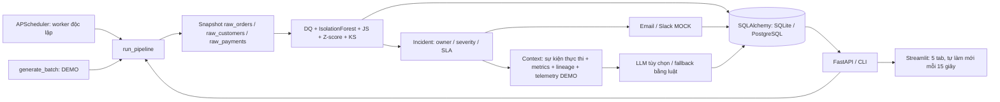

# NHÓM 6 — AI DATA OBSERVABILITY

**Đề tài AI 3:** Hệ thống Data Observability có AI phân tích nguyên nhân lỗi  
**Số thành viên:** 5  
**Phiên bản:** demo 5 task — chạy offline mặc định, LLM ngoài là tùy chọn

**Đối chiếu yêu cầu và bằng chứng code/test:** [TASK_CHECKLIST.md](TASK_CHECKLIST.md). Hướng dẫn vận hành Task 1 chi tiết: [TASK1_GUIDE.md](TASK1_GUIDE.md).

> **Giới hạn trung thực:** Đây là hệ thống chứng minh ý tưởng (proof-of-concept). Dataset giao dịch là dữ liệu sinh tổng hợp, không kết nối hệ thống doanh nghiệp thật; AI root-cause tạo giả thuyết dựa trên bằng chứng, không thay thế kết luận của kỹ sư. Chỉ dùng trong demo/lab nội bộ, không được công khai API chưa có xác thực.

## 1. Chạy nhanh nhất trên Windows

**Yêu cầu:** Python **3.11, 3.12 hoặc 3.13**, Internet để cài thư viện lần đầu, Windows 10/11.

1. Giải nén ZIP vào một thư mục, ví dụ `D:\AI_Data_Observability_Nhom6`.
2. Cài Python từ trang chính thức và tích ô **Add Python to PATH**.
3. **Nhấp đúp `run_demo.bat`**. File sẽ tạo `.venv`, cài package và khởi tạo dữ liệu mẫu.
4. Sau khi ba cửa sổ **FastAPI, Streamlit, Scheduler** xuất hiện, mở **http://127.0.0.1:8501**.
5. Mở tài liệu FastAPI tại **http://127.0.0.1:8000/docs**.
6. Giữ **cả ba cửa sổ CMD** đang chạy. Để dừng, nhấn **Ctrl+C trong từng cửa sổ**, đợi job hoàn tất rồi đóng cửa sổ.

Demo Task 1 mỗi 15 giây: chạy `run_demo.bat 15` trong CMD hoặc `./run_demo.bat 15` trong PowerShell. Mặc định là 300 giây; cũng có thể đặt `SCHEDULER_INTERVAL_SECONDS=15`. Worker từ chối mở bản thứ hai trong cùng thư mục project. Khi đổi chu kỳ, dừng worker cũ trước.

Hướng dẫn kiến trúc, bảng nguồn, API kiểm chứng và kịch bản trình bày 3–5 phút: **[TASK1_GUIDE.md](TASK1_GUIDE.md)**.

Lần đầu cài thư viện có thể phụ thuộc tốc độ mạng và cấu hình máy. Nếu Windows chặn chạy batch, dùng cách thủ công bên dưới.

## 2. Chạy thủ công trong CMD/PowerShell

**Windows CMD, tại thư mục project:**

```bat
py -3 -m venv .venv
.venv\Scripts\python.exe -m pip install -r requirements.txt
.venv\Scripts\python.exe -m observability.cli seed
.venv\Scripts\python.exe -m uvicorn observability.api:app --host 127.0.0.1 --port 8000
```

**Mở thêm CMD thứ hai, trong cùng thư mục:**

```bat
.venv\Scripts\python.exe -m streamlit run dashboard.py --server.address 127.0.0.1 --server.port 8501
```

**Mở CMD thứ ba cho scheduler độc lập:**

```bat
.venv\Scripts\python.exe -m observability.scheduler --interval 15
```

Chạy ngay khi khởi động rồi lặp mỗi 15 giây bằng APScheduler 3.x (`BlockingScheduler`, interval trigger). Bỏ `--interval 15` để dùng biến môi trường hoặc mặc định 300 giây. Log worker ở terminal và `logs/scheduler.log` (UTC, xoay vòng). FastAPI không khởi động scheduler và `/api/health` chỉ xác nhận API.

> Cơ sở dữ liệu mặc định là SQLite trong `data/observability.db`. **Không cần cài PostgreSQL hoặc đăng ký API AI** để trình diễn. SQLite chứa sẵn các kịch bản lịch sử nếu dùng ZIP này.

**macOS/Linux:** `bash run_demo.sh` (cần Python 3.11+).

## 3. Nếu đã cài Docker: bản có PostgreSQL và scheduler

```bash
docker compose up --build
```

Truy cập dashboard tại http://localhost:8501 và Swagger tại http://localhost:8000/docs.

- `postgres`: cơ sở dữ liệu PostgreSQL 16, lưu bằng Docker volume.
- `api`: FastAPI; tự khởi tạo lịch sử demo nếu DB trống.
- `dashboard`: Streamlit kết nối API nội bộ.
- `scheduler`: APScheduler chạy ngay lần đầu, sau đó **5 phút/lần**; đọc `SCHEDULER_INTERVAL_SECONDS`, chờ API healthy trước khi chạy. File log được gắn ra thư mục `logs/` trên máy.

Demo Docker 15 giây trong PowerShell: `$env:SCHEDULER_INTERVAL_SECONDS='15'; docker compose up --build`.

Dừng: `docker compose down`. Xóa toàn bộ dữ liệu PostgreSQL: `docker compose down -v` (chỉ khi muốn reset).

PostgreSQL demo dùng mật khẩu mẫu trong `compose.yaml` **không phù hợp triển khai production**. Cổng 8000/8501 chỉ ánh xạ về máy cục bộ.

## 4. Hệ thống làm được gì?

| Phần | Chức năng | Giải thích khi thuyết trình |
|---|---|---|
| Data Pipeline | Tạo batch, lưu ba bảng nguồn theo run, đo chất lượng, lưu lịch sử trong DB | Dữ liệu và kết quả được lưu cùng transaction |
| Data Quality | **8 quy tắc**: freshness, completeness, uniqueness, schema, validity, JS drift, amount drift, volume | Hiện observed / threshold / PASS-FAIL |
| Anomaly Detection | **Z-score** cho row_count/amount_mean và **IsolationForest + khoảng cách robust** học 9 đặc trưng từ lịch sử **HEALTHY** | Hiển thị baseline, score, ngưỡng và marker trên biểu đồ |
| Drift Detection | **KS-test** cho amount giữa hai snapshot liền kề; giữ **Jensen–Shannon Divergence** của payment so với HEALTHY | Hiển thị riêng ý nghĩa thống kê và mức thay đổi phân phối |
| Incident | Tự mở ticket, đặt P1/P2/P3, owner, SLA và timeline | Tiếp nhận, xem nguồn lỗi, đóng incident |
| AI Root Cause Analysis | RCA bằng luật + LLM tùy chọn, JSON kiểm tra bằng Pydantic, fallback offline | Luôn hiển thị **LLM** hoặc **RULE_BASED_FALLBACK**, cần con người xác minh |
| Notification | Email/Slack **MOCK**, lưu vào alerts và incident timeline | Không gọi dịch vụ gửi thật; trạng thái MOCK_SENT |
| Dashboard | 5 tab, đồ thị tương tác, bảng rule, timeline, truy vết nguyên nhân | Mỗi thành viên có một tab phù hợp task |
| Lập lịch | APScheduler 3.x, CLI, Docker Compose | Worker độc lập, interval trigger, không chạy job chồng lấn |

## 5. Gợi ý trình diễn 5 thành viên (5–8 phút)

### Thành viên 1 — Lê Hồ Hoàng Long: Bài toán và kiến trúc

1. Mở tab **01 – Tổng quan & Kiến trúc**.
2. Giải thích vì sao dashboard báo cáo thường chỉ phát hiện sai ở đầu ra mà không biết lỗi ở nguồn nào.
3. Giải thích lineage `raw_orders/raw_customers/raw_payments → stg_orders → fact_orders → dashboard_sales`.
4. Chỉ ra FastAPI + SQLite/Postgres + ETL Python + scheduler + Streamlit trong sơ đồ.
5. Chạy kịch bản **Bình thường**. Điểm DQ 100/100, không mở incident.

### Thành viên 2 — Trần Ngọc Trí: Kiểm tra chất lượng dữ liệu

1. Chọn **Dữ liệu đến trễ** trong sidebar rồi nhấn **Chạy kiểm tra dữ liệu**.
2. Mở tab **02 – Data Quality**, chọn run mới.
3. Chỉ **Freshness > 60 phút** màu lỗi. Giải thích ngưỡng, SLA và source telemetry.
4. Chạy thêm **Thiếu dữ liệu** để minh họa completeness; **Trùng khóa** để minh họa uniqueness; **Đổi schema** để minh họa data contract.
5. Nêu công thức: `Completeness = ô dữ liệu quan trọng khác NULL / tổng số ô dữ liệu quan trọng`.

### Thành viên 3 — Quách Khải Hậu: Bất thường và distribution drift

1. Chạy **Distribution drift**.
2. Mở tab **03 – Anomaly & Drift**. Chỉ đồ thị **JS divergence** và **giá trị đơn trung bình**.
3. So sánh thanh toán trước và sau; nêu JS Divergence là số đo thay đổi phân phối.
4. Giải thích **IsolationForest** học dữ liệu lịch sử khỏe, chạy kiểm tra độ lệch 9 chiều; ML hỗ trợ, không thay thế rule.
5. Chọn run `distribution_drift` hoặc `volume_spike`, xem Z-score và KS-test, chỉ các marker bất thường trên biểu đồ. KS so với run trước, JS so với baseline HEALTHY.

### Thành viên 4 — Trần Quang Long: Cảnh báo, SLA và incident

1. Mở tab **04 – Cảnh báo & SLA**. Chọn incident mới.
2. Giải thích `OPEN → ACKNOWLEDGED → RESOLVED` và actor trong timeline.
3. Chỉ severity P1/P2/P3, người chịu trách nhiệm, SLA deadline.
4. Nhấn **Tiếp nhận**, sau đó minh họa **Đóng incident** (hành động demo).
5. Xem email_mock/slack_mock và nội dung. Nhấn **Ghi nhận xử lý DEMO** giữa tiếp nhận và đóng để ghi lại bước mô phỏng trong timeline.

### Thành viên 5 — Trịnh Huỳnh Nam Sơn: AI tìm nguyên nhân và triển khai

1. Chạy **Lỗi upstream** và mở tab **05 – AI Root Cause**.
2. Chọn incident liên quan. Nêu căn cứ `raw_payments.status = ERROR`, thiếu `amount/payment_method`.
3. Giải thích kết luận AI là **giả thuyết có bằng chứng**, ưu tiên cao chứ không phải độ chính xác dự đoán đã đo.
4. Theo checklist: kiểm tra nguồn → đối soát dữ liệu → sửa pipeline → chạy lại → xác minh.
5. Giới thiệu triển khai Postgres + Docker + scheduler và các bổ sung khi production.
6. Chỉ rõ nguồn phân tích trong tab 05: mặc định **RULE_BASED_FALLBACK**. Với provider đã được phép cấu hình, có thể phân tích lại bằng LLM; nếu lỗi thì fallback có mã lý do.

## 6. Dữ liệu mẫu & các kịch bản test

| Kịch bản | Lỗi xuất hiện | Expected check |
|---|---|---|
| `normal` | Bản ghi giao dịch hợp lệ | 8/8 PASS |
| `late_data` | Thời gian sự kiện cũ ~180–240 phút | freshness FAIL |
| `null_values` | 28% amount, 12% customer_id bị thiếu | completeness FAIL |
| `duplicate_keys` | 65 order_id trùng | uniqueness FAIL |
| `schema_change` | `customer_id` đổi thành `customer_key` | schema FAIL |
| `distribution_drift` | Giá trị amount gấp 3, tỷ lệ bank_transfer ~92% | amount drift & JS drift FAIL |
| `upstream_failure` | raw_payments báo lỗi; amount/payment thiếu | completeness, validity FAIL |
| `volume_spike` | Số dòng từ 400 lên 1200 | volume FAIL |

Có thể chạy bằng lệnh:

```bash
python -m observability.cli run --scenario schema_change
python -m observability.cli run --scenario upstream_failure
python -m observability.cli run --scenario normal
```

> Khi chạy thủ công bằng `python`, hãy chắc chắn đó là Python thuộc `.venv` đã cài dependencies.

Nạp dữ liệu demo khi database chưa có lịch sử:

```bash
python -m observability.cli seed
```

`seed` giữ dữ liệu hiện có. Không dùng chức năng reset cũ nếu cần bảo toàn lịch sử nhóm.

Trong ZIP có sẵn `data/latest_orders.csv`: **dữ liệu được sinh hoàn toàn để demo**. File cập nhật sau mỗi lần chạy.

Các run mới còn lưu `raw_orders`, `raw_customers`, `raw_payments` theo `run_id`. `raw_orders.payload_json` giữ nguyên tên cột thực tế và NULL; khóa kỹ thuật cho phép lưu cả `order_id` trùng. Customer/payment là dữ liệu giả lập suy ra từ batch, không phải connector upstream độc lập. Telemetry upstream (ví dụ 8.000 customers hoặc 140 payments trong kịch bản lỗi) vẫn là mô phỏng, không phải số dòng đã lưu. `stg_orders` và `fact_orders` vẫn là các bước logic trên batch trong bộ nhớ, không phải bảng SQL mới.

Database cũ được bổ sung bảng bằng `create_all()`, không xóa hay sửa các bảng hiện hữu. Run cũ không được tự tạo lại snapshot: endpoint nguồn trả `snapshot_available=false`. Chạy pipeline mới để có dữ liệu nguồn kiểm chứng; không cần reset.

## 7. REST API

| Verb | URL | Mục đích |
|---|---|---|
| GET | `/api/health` | Kiểm tra server |
| GET | `/api/summary` | Chỉ số tổng quan |
| GET | `/api/runs` | Lịch sử chạy |
| POST | `/api/runs` | Chạy mô phỏng `{"scenario":"schema_change"}` |
| GET | `/api/runs/{id}` | Rule chi tiết và sample |
| GET | `/api/runs/{id}/sources?source=raw_orders&limit=50&offset=0` | Payload nguồn đã lưu, số dòng thực tế, phân trang (tối đa 500 dòng) |
| GET | `/api/metrics/trend` | Metrics phục vụ biểu đồ |
| GET | `/api/incidents` | Danh sách sự cố |
| GET | `/api/incidents/{id}` | Incident + timeline + AI RCA |
| POST | `/api/incidents/{id}/acknowledge` | Tiếp nhận |
| POST | `/api/incidents/{id}/resolve` | Đóng |
| GET | `/api/alerts` | Cảnh báo dashboard |
| GET | `/api/lineage` | Danh sách node/edge phụ thuộc |
| GET | `/api/config` | Ngưỡng DQ/thống kê, không trả API key |
| POST | `/api/incidents/{id}/analyze` | Phân tích lại, lưu nguồn phân tích và context đã lọc |
| POST | `/api/incidents/{id}/simulate-fix` | Ghi bước xử lý DEMO vào timeline, không sửa dữ liệu nguồn |
| POST | `/api/seed?reset=true` | Khởi tạo lại demo (local only) |

**Thử API**: mở http://localhost:8000/docs → chọn `POST /api/runs` → `Try it out` → chọn scenario → `Execute`.

## 8. Kiến trúc thư mục

```text
AI_Data_Observability_Nhom6/
├─ dashboard.py                 # Giao diện Streamlit: 5 phần demo
├─ observability/
│  ├─ api.py                    # FastAPI REST
│  ├─ settings.py               # Ngưỡng cảnh báo và cấu hình
│  ├─ database.py               # SQLAlchemy: runs/checks/incidents/timeline
│  ├─ generator.py              # Dữ liệu mô phỏng, upstream telemetry
│  ├─ quality.py                # Data quality và Jensen-Shannon Divergence
│  ├─ anomaly.py                # Machine Learning: IsolationForest
│  ├─ rca.py                    # AI assisted explainable root cause
│  ├─ service.py                # Pipeline và các xử lý nghiệp vụ
│  ├─ scheduler.py              # APScheduler BlockingScheduler, interval
│  ├─ sources.py                # Nạp/truy xuất snapshot nguồn theo run
│  ├─ logging_config.py         # Terminal + RotatingFileHandler
│  ├─ worker_lock.py            # Khóa chống worker trùng trong cùng project
│  └─ cli.py                    # CLI seed/reset/run
├─ data/
│  ├─ observability.db          # SQLite demo có sẵn dữ liệu
│  └─ latest_orders.csv         # Lô dữ liệu mẫu gần nhất
├─ tests/test_system.py        # Kiểm thử tự động
├─ requirements.txt
├─ run_demo.bat                 # Chạy nhanh Windows
├─ start_scheduler.bat          # Worker độc lập, hỗ trợ --interval 15
├─ TASK1_GUIDE.md               # Hướng dẫn và kịch bản demo Task 1
├─ run_demo.sh                  # Chạy nhanh macOS/Linux
├─ Dockerfile
└─ compose.yaml                 # Postgres + API + Dashboard + scheduler
```

## 9. Kiểm thử và tính đúng đắn

```bash
python -m pip install -r requirements-test.txt
python -m pytest -q
```

Các bài test kiểm tra 8 kịch bản, incident/timeline/RCA, REST API, snapshot nguồn, nâng cấp DB cũ, rollback, log, khóa worker, interval thực thi theo đồng hồ giả và khôi phục sau exception. Có smoke test tiến trình worker thật với hai lượt chạy chu kỳ 1 giây trên DB tạm. Test không sửa DB demo hoặc CSV hiện có. Cấu trúc bảng PostgreSQL được kiểm tra bằng biên dịch DDL; điều đó không thay cho kiểm thử tích hợp PostgreSQL thật.

**Công thức cốt lõi:**

- Freshness lag: thời gian hiện tại trừ event_time mới nhất.
- Completeness: tỷ lệ giá trị không null trong các cột bắt buộc.
- Uniqueness: `1 - duplicated(order_id)/row_count`.
- JS Divergence: trung bình hai KL-divergence tới phân phối trung gian, có miền [0,1].
- ML novelty: tính IsolationForest decision score và độ lệch robust có ngưỡng theo từng đặc trưng so với healthy history; nhằm phát hiện tín hiệu mạnh ngay khi dữ liệu lịch sử còn ít.
- Điểm chất lượng: số rule đạt / tổng số rule * 100.
- RCA: ưu tiên giả thuyết dựa trên *kết quả phép kiểm tra + telemetry upstream + sơ đồ phụ thuộc*; không dựa vào nhãn scenario.

## 10. Giới hạn và hướng phát triển

- Chưa có ingestion thật, CDC/Kafka connector hoặc dbt chính thức; dùng **Python ETL thay thế dbt** vì mục tiêu demo dễ chạy.
- Dashboard không có đăng nhập; API `seed/reset` và hành động incident không được dùng trên mạng công cộng nếu chưa kiểm soát truy cập.
- Alerts hiện ở dashboard, không gửi email, SMS, Slack thật.
- Email/Slack được mô phỏng bằng `alerts.channel=email_mock/slack_mock`, `delivery_status=MOCK_SENT`; giao diện hiển thị nội dung và timeline.
- SLA thực tế thường kết hợp lịch hoạt động và lịch làm việc; phiên bản demo tính theo số phút tĩnh.
- Không phải tất cả bất thường đều do lỗi: anomaly và drift cần data owner xác thực.
- Chưa đánh giá độ chính xác RCA trên bộ incident có nhãn; `confidence` là **điểm ưu tiên heuristic**, không phải xác suất được hiệu chuẩn.
- Dữ liệu hiện dùng một fact_orders, cần mở rộng registry đa dataset, baseline theo chu kỳ, API auth/RBAC, CI/CD, observability cho chính pipeline, test tách train/test, bias theo mùa vụ, data retention và quản lý secrets nếu đưa lên thật.

## 11. Tài liệu tham khảo kỹ thuật chính thức

- FastAPI: https://fastapi.tiangolo.com/
- Streamlit: https://docs.streamlit.io/develop/concepts/architecture/run-your-app
- scikit-learn Isolation Forest: https://scikit-learn.org/stable/modules/generated/sklearn.ensemble.IsolationForest.html
- SQLAlchemy: https://docs.sqlalchemy.org/en/20/
- APScheduler 3.x: https://apscheduler.readthedocs.io/en/3.x/userguide.html
- Docker Compose: https://docs.docker.com/compose/
- PostgreSQL: https://www.postgresql.org/docs/

**Liên hệ với yêu cầu 5 task:** Tab 1 = kiến trúc / bài toán; tab 2 = chất lượng; tab 3 = anomaly/drift; tab 4 = cảnh báo/SLA/timeline; tab 5 = AI RCA / checklist / triển khai.

## 12. Kiến trúc và file phụ trách theo đúng 5 task



Biểu đồ thể hiện luồng dữ liệu logic. DQ/ML được tính trên batch gốc trong bộ nhớ; snapshot và các kết quả được commit trong cùng transaction. KS đọc snapshot vừa flush và snapshot của run trước. LLM chỉ được gọi sau core commit, không giữ transaction ghi trong khi chờ dịch vụ ngoài.

| Task | File triển khai chính | Công nghệ |
|---|---|---|
| 1 | `database.py`, `sources.py`, `generator.py`, `scheduler.py`, `logging_config.py`, `worker_lock.py`, `service.py`, `api.py` | SQLAlchemy, SQLite/PostgreSQL, APScheduler 3.x, FastAPI, logging |
| 2 | `quality.py`, `settings.py`, `generator.py`, `service.py`, `dashboard.py` | Freshness, completeness, uniqueness, schema; kết quả PASS/FAIL |
| 3 | `statistics.py` (mới), `anomaly.py`, `quality.py`, `service.py`, `dashboard.py` | Z-score, scipy KS-test, IsolationForest/RobustScaler, JS, Plotly |
| 4 | `notifications.py` (mới), `service.py`, `database.py`, `api.py`, `dashboard.py` | Email/Slack MOCK, alerts, timeline, owner, SLA |
| 5 | `llm_rca.py` (mới), `rca.py`, `service.py`, `api.py`, `dashboard.py`, `compose.yaml`, `Dockerfile` | HTTP OpenAI-compatible, Pydantic v2, deterministic fallback, Docker |

Tên module trong bảng thuộc `observability/`, trừ dashboard và các file Docker ở thư mục gốc. Các test mới: `test_statistics.py`, `test_notifications.py`, `test_llm_rca.py`, `test_full_workflow.py`, `test_live_schedule.py`.

Schema nâng cấp thêm `pipeline_events` để lưu **sự kiện thực thi có thật**: STARTED, SNAPSHOT_SAVED, FINISHED kèm run ID/thời điểm. `/api/runs/{id}` trả `execution_logs`. Đây là sự kiện cấu trúc trong DB; không giả nhận đã đọc file log của các run lịch sử. Với run cũ chưa có sự kiện, danh sách rỗng. Không ALTER/xóa bảng cũ, không backfill snapshot/log giả.

## 13. Cấu hình ngưỡng DQ và thuật toán thống kê

Tạo `.env` từ `.env.example` nếu chưa có; giữ file `.env` và API key ngoài Git. Sửa cấu hình rồi khởi động lại API và worker. Cấu hình DQ có tiền tố `DQ_`, các phép so sánh và nhãn ngưỡng đọc từ cùng một nguồn. Ngưỡng thực tế của run mới được lưu trong `metrics.quality_thresholds`.

| Biến | Mặc định | Ý nghĩa |
|---|---|---|
| `DQ_FRESHNESS_MINUTES` | 60 | Độ trễ tối đa |
| `DQ_COMPLETENESS` | 0.98 | Tỷ lệ đầy đủ tối thiểu |
| `DQ_UNIQUENESS` | 0.995 | Tỷ lệ duy nhất tối thiểu |
| `DQ_SCHEMA_MATCH` | 1 | Schema phải khớp chính xác; không hỗ trợ nới lỏng |
| `ZSCORE_THRESHOLD` | 3 | Cảnh báo khi \|Z\| > ngưỡng |
| `ZSCORE_MIN_HISTORY` | 5 | Số run HEALTHY tối thiểu cho từng chỉ số |
| `KS_ALPHA` | 0.05 | Ngưỡng p-value |
| `KS_MIN_SAMPLES` | 20 | Số amount hợp lệ tối thiểu ở mỗi snapshot |
| `KS_EFFECT_THRESHOLD` | 0.1 | KS D tối thiểu để cảnh báo cùng với p-value |

Các ngưỡng phụ: `DQ_PAYMENT_VALIDITY`, `DQ_DISTRIBUTION_JS`, `DQ_AMOUNT_MEAN_RATIO`, `DQ_VOLUME_RATIO_LOW`, `DQ_VOLUME_RATIO_HIGH`. Docker truyền cùng cấu hình cho API và scheduler qua phần environment dùng chung trong Compose.

**Z-score** dùng tối đa 40 run HEALTHY trước đó, cùng dataset, độ lệch chuẩn tổng thể (`ddof=0`). Không đủ lịch sử: `INSUFFICIENT_HISTORY`. Phương sai bằng 0 và giá trị bằng baseline: Z=0; khác baseline: `ALERT`, Z=`null` với lý do `zero_variance` để tránh Infinity. Trường hợp này nhạy với mọi thay đổi của baseline hằng, cần con người kiểm tra. Z-score có thể làm run FAILED dù 8 rule DQ PASS; các run này không vào baseline HEALTHY. IsolationForest + khoảng cách robust vẫn giữ nguyên.

**KS-test** sử dụng toàn bộ amount hữu hạn, không NULL, từ hai snapshot cùng dataset có run ID liên tiếp, không dùng preview 12 dòng hoặc chỉ trung bình. Không bỏ qua run lỗi/legacy để chọn một run thuận tiện hơn. Thiếu snapshot hoặc mẫu: báo trạng thái bỏ qua với lý do. `significant` là p < alpha; `effect_detected` là D ≥ ngưỡng; `ALERT` cần cả hai. KS là chẩn đoán, không tự đổi trạng thái pipeline: run phục hồi có thể khác đáng kể run lỗi ngay trước. JS tiếp tục so sánh payment_method với baseline HEALTHY.

Tab 03 hiển thị bảng thống kê từng run, marker Z-score/KS/IsolationForest và lịch sử KS D. Run cũ chưa có metrics mới được hiển thị là chưa có kết quả; không tự suy diễn lại lịch sử.

## 14. LLM RCA tùy chọn và chế độ offline

Mặc định không cần Internet hoặc key sau khi đã cài dependencies:

```dotenv
LLM_MODE=offline
LLM_ALLOW_EXTERNAL=false
```

Giao diện hiển thị `RULE_BASED_FALLBACK`; tóm tắt, upstream nghi ngờ, bằng chứng và checklist được tạo bằng luật hiện có. Email/Slack chỉ là MOCK. Không gọi provider để chạy demo offline.

Nếu đã có provider tương thích Chat Completions, cấu hình riêng trong `.env`:

```dotenv
LLM_MODE=openai_compatible
LLM_ALLOW_EXTERNAL=true
LLM_BASE_URL=https://your-provider.example/v1
LLM_MODEL=your-configured-model
LLM_API_KEY=your-own-key
LLM_TIMEOUT_SECONDS=10
```

URL/model/key ở trên là chỗ điền cấu hình của bạn. Module gọi `POST {LLM_BASE_URL}/chat/completions`; muốn đổi provider hãy đổi URL, model và key tương thích. Cần provider hỗ trợ `response_format=json_object`. Dịch vụ local trên localhost có thể dùng HTTP; dịch vụ ngoài dùng HTTPS. Timeout cấu hình 1–30 giây cho pha đọc, connect tối đa 3 giây; không tự retry hoặc chuyển hướng HTTP. Cần bật cả mode và `LLM_ALLOW_EXTERNAL=true` mới cho phép gửi context.

Context được lọc theo allowlist: incident/run ID, severity, kết quả rule, ngưỡng đã lưu, metrics, IsolationForest, Z-score/KS, loại/thời gian sự kiện thực thi, telemetry upstream và lineage. Không gửi snapshot, order/customer ID, toàn bộ giao dịch, free-text log hay cấu hình bí mật. Telemetry upstream được giữ rõ là DEMO trong hệ thống; đây không phải kết nối vận hành doanh nghiệp. Không dùng nhãn scenario làm bằng chứng chẩn đoán.

Output JSON được kiểm tra bằng Pydantic: kết luận/tóm tắt, giả thuyết, node nghi ngờ, checklist, tham chiếu bằng chứng hợp lệ và `human_review_required=true`. Node phải thuộc lineage; upstream phải là tổ tiên của dataset; evidence phải tham chiếu ngữ cảnh được cung cấp. Cơ chế này kiểm tra cấu trúc và nguồn tham chiếu, không chứng minh nội dung suy luận là đúng.

Thành công ghi `analysis_source=LLM`. Thiếu cấu hình, chưa cho phép gửi, timeout, lỗi HTTP hoặc JSON/grounding không hợp lệ sẽ dùng `RULE_BASED_FALLBACK` và `fallback_reason_code` cố định, không ghi key/raw lỗi provider vào log. Kết quả và context được lưu dưới `incident.root_cause.ai_analysis/analysis_context`, giữ báo cáo bằng luật cũ để đối chiếu.

Có thể nhấn **Phân tích lại incident** ở tab 05 hoặc gọi API:

```powershell
# Thay 1 bằng incident ID thật
Invoke-RestMethod -Method Post http://127.0.0.1:8000/api/incidents/1/analyze
```

## 15. Demo 5 task cho giảng viên (khoảng 5–8 phút)

Chuẩn bị dependencies trước buổi demo. Không reset dữ liệu. Nếu database mới, `seed` tạo 10 run khỏe làm baseline; nếu đã có lịch sử thì giữ nguyên.

1. **Task 1:** `./run_demo.bat 15`. Mở dashboard, để checkbox tự làm mới 15 giây. Chỉ hai run tự tăng, terminal/log và ba snapshot nguồn. API health chỉ chứng minh API, không chứng minh worker đang sống.
2. **Task 2:** Chạy `late_data`, `null_values`, `duplicate_keys`, `schema_change` từ sidebar; tab 02 chỉ observed/ngưỡng, PASS/FAIL, severity, run ID và thời điểm.
3. **Task 3:** Chạy `distribution_drift` và `volume_spike`, chọn run ở tab 03. Chỉ Z-score amount/row_count, KS D/p-value và marker. Đối chiếu với IsolationForest và JS vẫn có sẵn. Run normal tiếp theo có thể có KS ALERT do so với run lỗi trước đó; giải thích phục hồi này.
4. **Task 4:** Tab 04 chọn incident mới, mở email_mock/slack_mock. Nhấn **Tiếp nhận → Ghi nhận xử lý DEMO → Đóng incident**. Timeline giữ đủ thông báo và thao tác, không khẳng định đã sửa dữ liệu thật.
5. **Task 5:** Tab 05 chỉ nguồn `RULE_BASED_FALLBACK` khi offline, context/log/lineage, giả thuyết upstream và checklist. Nếu có cấu hình provider được phép, nhấn phân tích lại để thử LLM; khi lỗi sẽ hiển thị fallback. Cuối cùng giới thiệu Compose bốn service và giới hạn kiểm chứng bên dưới.

Dừng bằng Ctrl+C trong ba terminal, chờ worker hoàn tất job; Docker dùng `docker compose down` để giữ volume. Không tắt hàng loạt tiến trình Python.

## 16. Kiểm chứng thực tế và giới hạn

Các kết quả mới nhất được ghi tại [TASK_CHECKLIST.md](TASK_CHECKLIST.md), kèm tên test làm bằng chứng. Test dùng DB/CSV/log/lock tạm, không reset database nhóm. Có test worker thật hai lượt **15 giây**, test Streamlit `AppTest` render đủ 5 tab qua API FastAPI thật trong tiến trình test, và kiểm tra toàn bộ 8 scenario.

Kết quả thực tế ngày 21/11/2026: **162 passed, 2 warnings in 38.83s**. Sau bổ sung nhãn DEMO trong context LLM, chạy lại 79 test LLM/workflow liên quan: **79 passed, 2 warnings in 7.11s**. Hai warning deprecation thuộc Starlette/httpx và Streamlit/NumPy, không có test thất bại. `compileall`, `pip check`, `git diff --check` đều qua. Smoke HTTP Uvicorn thật qua health, tạo run lỗi, snapshot, mock notification, fallback RCA và Swagger; server dùng DB tạm rồi dừng.

Checksum DB demo trước/sau giữ nguyên (`D1894A6B6D562A0813C5601F82669E20FD8C5359884E0D608A0C9892910CF27E`). Code chỉ bổ sung bảng `pipeline_events` khi khởi động; không sửa lại lịch sử cũ.

Chạy kiểm thử:

```powershell
.venv/Scripts/python.exe -m pip install -r requirements-test.txt
.venv/Scripts/python.exe -m compileall -q observability tests dashboard.py
.venv/Scripts/python.exe -m pytest -q
.venv/Scripts/python.exe -m pip check
```

Trong môi trường triển khai lần này chưa có Docker/PostgreSQL server để chạy Compose thật. Chỉ kiểm tra YAML, service/healthcheck/dependency và biên dịch DDL PostgreSQL. Chưa gọi provider LLM thật bằng key người dùng; nhánh HTTP được kiểm thử mock. AppTest không thay thế kiểm tra bằng mắt trong trình duyệt. Không tuyên bố đã deploy production.

Database hiện có được giữ nguyên. Source vẫn tổng hợp; `stg_orders/fact_orders` là bước logic, chưa có CDC hoặc connector doanh nghiệp. Exception kỹ thuật trước commit rollback và vào file log worker, chưa có hàng run hoàn tất; các rule FAIL vẫn lưu lịch sử đầy đủ. Hệ thống chưa có auth/RBAC, distributed lock hoặc đánh giá độ chính xác RCA trên incident có nhãn. Nội dung LLM luôn là giả thuyết cần con người xác minh.
