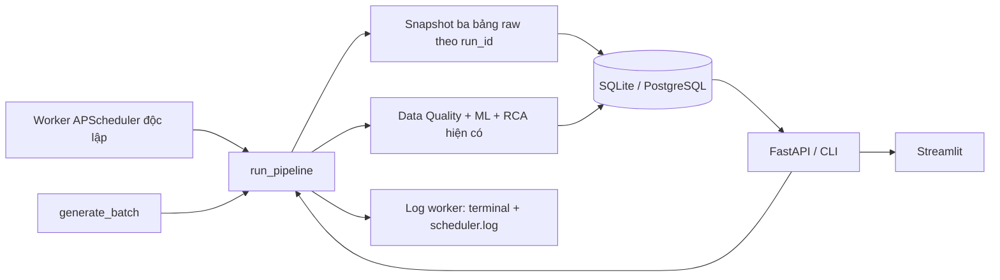

# Task 1 — Kiến trúc, pipeline mẫu và APScheduler

Hướng dẫn cho workspace AI Data Observability Nhóm 6. Các lệnh Windows bên dưới chạy tại thư mục gốc project, dùng Python trong `.venv`. Không cần reset database để cập nhật Task 1.

## 1. Thành phần và kiến trúc



| Thành phần | Mã nguồn | Vai trò |
|---|---|---|
| Database | `observability/database.py` | SQLAlchemy; SQLite mặc định, PostgreSQL qua `DATABASE_URL` |
| Sinh dữ liệu | `observability/generator.py` | `generate_batch()` và 8 kịch bản sẵn có |
| Nạp/truy xuất nguồn | `observability/sources.py` | `load_source_batch()` dùng lại batch; `get_sources()` đọc snapshot theo run |
| Pipeline | `observability/service.py` | DQ, ML, incident, RCA, snapshot, lịch sử và CSV |
| Scheduler | `observability/scheduler.py` | APScheduler 3.x, `BlockingScheduler`, interval trigger |
| Log | `observability/logging_config.py` | Logging chuẩn Python; terminal và file xoay vòng |
| Khóa worker | `observability/worker_lock.py` | Khóa hệ điều hành, tránh mở worker trùng trong cùng project |
| API / giao diện | `observability/api.py`, `dashboard.py` | REST API FastAPI và dashboard Streamlit hiện có |

Scheduler là tiến trình riêng. FastAPI không tạo job, kể cả khi chạy `--reload`. Mặc định worker chạy `normal` ngay sau khi khởi động và lặp mỗi **300 giây**. `--interval` ưu tiên hơn biến môi trường `SCHEDULER_INTERVAL_SECONDS`; giá trị phải là số nguyên dương.

Job có `max_instances=1`, `coalesce=True`, executor một luồng. Nếu lượt trước chưa kết thúc, lượt đến hạn bị bỏ qua; các lượt trễ được gộp thay vì chạy dồn. Khi job ném exception, worker giữ lịch để thử ở chu kỳ sau. Ctrl+C chờ pipeline hiện hành kết thúc.

## 2. Bảng database

| Bảng | Chức năng |
|---|---|
| `raw_orders` | Snapshot đầy đủ đơn hàng của batch; cột nghiệp vụ cho truy vấn, payload JSON giữ cấu trúc nguồn |
| `raw_customers` | Khách hàng giả lập suy ra từ các định danh có trong batch; tên dạng `Demo customer ...` |
| `raw_payments` | Một bản ghi thanh toán giả lập cho mỗi dòng order; giữ amount/method NULL và các tham chiếu trùng |
| `pipeline_runs` | Lịch sử run, scenario, thời gian, trạng thái, số dòng, duration, schema, metrics, preview và telemetry |
| `quality_checks` | Kết quả từng rule, liên kết `run_id` |
| `incidents` | Sự cố, mức ưu tiên, owner, SLA và kết quả RCA |
| `incident_events` | Timeline của incident |
| `alerts` | Cảnh báo demo hiển thị trên dashboard |

Ba bảng raw có `id` tự tăng làm khóa chính, `run_id` làm khóa ngoại tới `pipeline_runs.id`, index theo run, `row_number` và `payload_json`. Không có UNIQUE/FK nghiệp vụ trên `order_id` hoặc `customer_id`: dữ liệu lỗi vẫn được lưu. Khách hàng thiếu định danh không được tự sinh ID bù.

**Payload là dữ liệu gốc có thẩm quyền.** Các cột SQL cố định chỉ là hình chiếu hỗ trợ truy vấn. Trong `schema_change`, `raw_orders.customer_id` là SQL NULL nhưng `payload_json` **không có khóa `customer_id`**, có `customer_key`. `pipeline_runs.schema_json` giữ danh sách cột thật. Vì vậy không được dùng riêng schema vật lý của bảng SQL để kết luận batch đã đúng schema. Với `null_values`, khóa có mặt và giá trị JSON `null`; NULL không bị điền lại. Các dòng duplicate không bị loại bỏ.

**Phân biệt dữ liệu và mô phỏng:** ba bảng raw có dữ liệu giả lập thật được lưu trong DB. Customer/payment được suy ra từ chính batch, chưa đọc từ ba connector độc lập. `upstream` trong API run vẫn là telemetry mô phỏng để Task 2–5 phân tích RCA. Ví dụ `raw_customers.rows=8000` trong telemetry không đồng nghĩa có 8.000 dòng đã lưu; `upstream_failure` báo 140 payments nhưng snapshot vẫn có 400 dòng với dữ liệu thiếu. Endpoint nguồn trả `stored_counts` thực tế và `upstream_telemetry_simulated=true`.

`stg_orders`, `fact_orders`, `dashboard_sales` trong lineage là các bước logic/consumer. Task 1 không tạo thêm ba bảng SQL này hoặc thay pipeline bằng một phép join có thể làm mất dòng lỗi.

## 3. Luồng pipeline và tương thích database cũ

1. Khởi tạo các bảng còn thiếu bằng `Base.metadata.create_all()`.
2. Lấy lịch sử HEALTHY và sinh batch bằng `generate_batch()` hiện có.
3. Kiểm tra trực tiếp batch nguyên bản bằng DQ/ML hiện có; không điền NULL, sửa schema hay loại duplicate trước khi kiểm tra.
4. Trong cùng transaction, lưu `pipeline_runs`, ba snapshot nguồn, các quality check và incident/alert/RCA khi cần. Snapshot chính là batch đã dùng để kiểm tra.
5. Cập nhật thời điểm kết thúc và duration, commit, xuất `data/latest_orders.csv` như trước. File CSV chỉ giữ batch gần nhất; DB giữ snapshot từng run.
6. Worker ghi log bắt đầu/kết thúc với run ID, trạng thái, số dòng, duration; API cung cấp lịch sử cho dashboard.

Nâng cấp chỉ thêm bảng mới, không sửa cấu trúc hay xóa dữ liệu ở năm bảng cũ. Run cũ tiếp tục đọc được, nhưng không thể phục hồi nguyên batch từ preview 12 dòng; không backfill giả. Endpoint nguồn trả `snapshot_available=false` và `stored_counts=0` cho những run này. Chạy một run mới để tạo snapshot.

`FAILED` là kết quả giám sát phát hiện lỗi dữ liệu, vẫn lưu lịch sử và snapshot. Exception kỹ thuật trước commit sẽ rollback transaction, ghi traceback vào log worker, chưa có hàng lịch sử hoàn tất cho lần đó. Nếu xuất CSV lỗi sau commit, DB vẫn giữ run; log có `committed=True` để phân biệt. Run ID trong log của transaction rollback chỉ là ID tạm được cấp, không chứng minh một run đã commit. Duration trong DB đo tới khi chuẩn bị commit, không gồm xuất CSV.

Không chạy lệnh reset hoặc endpoint seed với `reset=true` khi muốn giữ dữ liệu. Chức năng reset cũ vẫn tồn tại cho nhu cầu chủ động của nhóm và đã được cập nhật thứ tự xóa bảng con; các script khởi động chỉ dùng seed không phá hủy dữ liệu.

## 4. Chạy nhanh trên Windows

Trong **PowerShell**:

```powershell
# Mặc định 300 giây
./run_demo.bat

# Hoặc demo 15 giây (chọn một trong hai lệnh khởi động)
./run_demo.bat 15
```

Trong **CMD** dùng `run_demo.bat 15`. Script tạo `.venv` nếu cần, cài requirements, seed nếu DB chưa có run và mở ba terminal FastAPI, Streamlit, Scheduler. Trạng thái launcher là đã gửi lệnh; đọc terminal từng thành phần để xác nhận khởi động thành công.

- API health: http://127.0.0.1:8000/api/health
- Swagger: http://127.0.0.1:8000/docs
- Dashboard: http://127.0.0.1:8501
- Log worker: `logs/scheduler.log`

Chạy lại launcher khi worker còn sống không tạo thêm scheduler: worker thứ hai từ chối lấy khóa. Để đổi chu kỳ, dừng worker cũ trước rồi chạy `./start_scheduler.bat --interval 15`. API/Streamlit mở trùng sẽ báo cổng đã được sử dụng; giữ các cửa sổ đang phục vụ và đóng các cửa sổ báo lỗi.

**Dừng ứng dụng:** Ctrl+C trong cả ba terminal, đợi scheduler báo `Worker stopped`, sau đó đóng cửa sổ. `DUNG_UNG_DUNG.bat` nhắc lại hướng dẫn này. Không tắt hàng loạt Python của máy. File `data/scheduler.lock` còn tồn tại sau khi dừng là bình thường: khóa nằm ở hệ điều hành, tự giải phóng khi tiến trình thoát; sự tồn tại của file không chứng minh worker đang sống.

## 5. Chạy từng thành phần thủ công

Chuẩn bị một lần trong PowerShell:

```powershell
py -3 -m venv .venv
$env:PYTHONUTF8='1'
.venv/Scripts/python.exe -m pip install -r requirements.txt
.venv/Scripts/python.exe -m observability.cli seed
```

Nếu `.venv` đã có thì bỏ lệnh tạo môi trường. Mở ba terminal cùng thư mục project.

**Terminal 1 — FastAPI:**

```powershell
.venv/Scripts/python.exe -m uvicorn observability.api:app --host 127.0.0.1 --port 8000
```

**Terminal 2 — Streamlit:**

```powershell
.venv/Scripts/python.exe -m streamlit run dashboard.py --server.address 127.0.0.1 --server.port 8501
```

**Terminal 3 — APScheduler:**

```powershell
.venv/Scripts/python.exe -m observability.scheduler --interval 15
```

Hoặc cấu hình qua môi trường, không sửa code:

```powershell
$env:SCHEDULER_INTERVAL_SECONDS='15'
.venv/Scripts/python.exe -m observability.scheduler
```

CMD tương đương: `set SCHEDULER_INTERVAL_SECONDS=15`, rồi `.venv\Scripts\python.exe -m observability.scheduler`. Có thể đặt biến này trong `.env` theo `.env.example`. Launcher Windows dùng 300 giây khi không có biến môi trường hay tham số; muốn launcher dùng 15 giây hãy đặt biến ở shell hoặc truyền `15` trực tiếp.

Chạy một batch và nạp dữ liệu nguồn thủ công:

```powershell
.venv/Scripts/python.exe -m observability.cli run --scenario normal
.venv/Scripts/python.exe -m observability.cli run --scenario duplicate_keys
.venv/Scripts/python.exe -m observability.cli run --scenario schema_change
```

Đây là script nạp demo qua CLI, dùng lại `generate_batch()` và `load_source_batch()`, đồng thời tạo run để gắn nguồn. Không có thao tác tự sửa dữ liệu lỗi.

## 6. Kiểm chứng lịch sử và dữ liệu bằng API

PowerShell, khi API đang chạy:

```powershell
Invoke-RestMethod http://127.0.0.1:8000/api/health
$runs = Invoke-RestMethod 'http://127.0.0.1:8000/api/runs?limit=5'
$runs | Select-Object id,scenario,status,row_count,started_at,finished_at,duration_ms
$runId = $runs[0].id
Invoke-RestMethod "http://127.0.0.1:8000/api/runs/$runId" | ConvertTo-Json -Depth 10
Invoke-RestMethod "http://127.0.0.1:8000/api/runs/$runId/sources?source=raw_orders&limit=3" | ConvertTo-Json -Depth 10
Invoke-RestMethod "http://127.0.0.1:8000/api/runs/$runId/sources?source=raw_customers&limit=3" | ConvertTo-Json -Depth 10
Invoke-RestMethod "http://127.0.0.1:8000/api/runs/$runId/sources?source=raw_payments&limit=3" | ConvertTo-Json -Depth 10
Invoke-RestMethod http://127.0.0.1:8000/api/summary
Invoke-RestMethod http://127.0.0.1:8000/api/lineage
```

Chạy lại lệnh lấy `$runs` sau khoảng 15–30 giây để thấy ID/thời gian mới. Lịch sử một mình không chứng minh scheduler còn sống: đối chiếu thêm terminal worker và log mới. `/api/health` chỉ xác nhận API, không báo trạng thái scheduler. Không có endpoint giả định worker đang chạy.

Tạo run lỗi từ API:

```powershell
$bad = Invoke-RestMethod -Method Post -Uri http://127.0.0.1:8000/api/runs -ContentType 'application/json' -Body '{"scenario":"schema_change"}'
$bad.checks | Where-Object { -not $_.passed }
Invoke-RestMethod "http://127.0.0.1:8000/api/runs/$($bad.id)/sources?limit=1" | ConvertTo-Json -Depth 10
```

Endpoint nguồn dùng `source` thuộc ba tên bảng, `limit=1..500`, `offset>=0`. Payload `rows` là dữ liệu thật đã lưu, `order_columns` là schema batch. Các endpoint dashboard dùng trước đây giữ nguyên tên và cấu trúc kết quả.

## 7. Kiểm tra SQLite trực tiếp, chỉ đọc

Sau ít nhất một run mới, chạy trong PowerShell (không cần cài sqlite CLI):

```powershell
@'
import json
import sqlite3
from pathlib import Path
uri = Path("data/observability.db").resolve().as_uri() + "?mode=ro"
with sqlite3.connect(uri, uri=True) as db:
    print("Tables:", db.execute("SELECT name FROM sqlite_master WHERE type='table' ORDER BY name").fetchall())
    run_id = db.execute("SELECT MAX(id) FROM pipeline_runs").fetchone()[0]
    print("Latest run:", run_id)
    for table in ("raw_orders", "raw_customers", "raw_payments"):
        print(table, db.execute(f"SELECT COUNT(*) FROM {table} WHERE run_id=?", (run_id,)).fetchone()[0])
    print("Columns:", db.execute("SELECT schema_json FROM pipeline_runs WHERE id=?", (run_id,)).fetchone()[0])
    row = db.execute("SELECT payload_json FROM raw_orders WHERE run_id=? ORDER BY row_number LIMIT 1", (run_id,)).fetchone()
    print("Stored payload:", json.loads(row[0]) if row else "Legacy run without snapshot")
'@ | .venv/Scripts/python.exe -
```

Lệnh này dành cho SQLite mặc định. Nếu đã đổi `DATABASE_URL` sang PostgreSQL, dùng endpoint nguồn hoặc công cụ SQL kết nối đúng database. Không suy luận schema của batch từ cột SQL cố định.

## 8. Xem log

```powershell
Get-Content logs/scheduler.log -Tail 30
Get-Content logs/scheduler.log -Tail 10 -Wait
```

Ctrl+C để thoát chế độ theo dõi log. File dùng UTF-8 và thời gian UTC (`Z`, giờ Việt Nam = UTC + 7), tối đa 5 MiB/file, giữ ba bản quay vòng. Log worker có `started_at`, `finished_at`, `run_id`, `status`, `rows`, `duration_ms`. Exception có traceback và cờ commit; không log toàn bộ giao dịch. Không gắn lặp handler khi cấu hình nhiều lần.

File này phục vụ tiến trình scheduler; run từ API/CLI vẫn có lịch sử DB, còn thông báo logging của service đi qua cấu hình logging của tiến trình gọi. API không tự mở file worker. SQLAlchemy engine ẩn tham số trong exception để hạn chế đưa payload vào log lỗi SQL.

## 9. Docker Compose và Linux/macOS

PowerShell, chu kỳ 15 giây:

```powershell
$env:SCHEDULER_INTERVAL_SECONDS='15'
docker compose up --build
```

Compose giữ bốn service PostgreSQL, API, dashboard, scheduler. Worker chờ API healthy để tránh đua khởi tạo/seed DB. `./logs` được mount vào `/app/logs`. Dừng bằng `docker compose down`, không thêm `-v` nếu muốn giữ dữ liệu PostgreSQL.

Linux/macOS: `SCHEDULER_INTERVAL_SECONDS=15 bash run_demo.sh`. Script chạy API, scheduler và Streamlit, theo dõi PID các tiến trình nó tạo để dừng khi thoát. Khóa worker chỉ bảo vệ trong cùng thư mục project/không gian filesystem; không phải distributed lock giữa nhiều máy hoặc container. Chỉ chạy một replica scheduler trong demo.

## 10. Kiểm thử

```powershell
$env:PYTHONUTF8='1'
.venv/Scripts/python.exe -m pip install -r requirements-test.txt
.venv/Scripts/python.exe -m pytest -q
# Chỉ Task 1:
.venv/Scripts/python.exe -m pytest tests/test_task1.py -q
```

`tests/test_system.py` giữ nguyên. Test Task 1 dùng SQLite tạm, bật kiểm tra khóa ngoại; chuyển cả session và đường dẫn CSV sang thư mục tạm. Smoke test worker cũng chuyển database, log, CSV và lock sang thư mục tạm. Không gọi reset trên `data/observability.db`.

Phạm vi: tạo đủ bảng; lưu/truy xuất theo run; normal và lịch sử; NULL/duplicate/schema lỗi vẫn bị phát hiện sau đọc lại; telemetry khác số dòng lưu; nâng cấp DB cũ; rollback khi nạp lỗi; reset chủ động trên DB tạm; REST API; đồng hồ giả điều khiển cơ chế dispatch thật của APScheduler; exception không làm mất lịch; không chạy chồng; khóa tiến trình; log không lặp; cấu hình chu kỳ và dừng an toàn. Smoke test dùng worker thật chạy hai lượt với interval 1 giây.

Test PostgreSQL hiện biên dịch DDL bằng dialect PostgreSQL, chưa thay thế chạy thật với PostgreSQL/Docker. Cần ghi riêng kết quả môi trường thực tế khi báo cáo, không coi kiểm tra cấu trúc là đã chạy Compose.

## 11. Kịch bản demo 3–5 phút

1. **0:00–0:45:** Chạy `./run_demo.bat 15` sau khi đã cài dependencies. Mở dashboard và Swagger; giới thiệu ba tiến trình, DB và luồng batch → snapshot + giám sát → lịch sử/incident.
2. **0:45–1:30:** Chỉ terminal scheduler: lượt đầu chạy ngay, có run ID, status, 400 rows, duration. Mở `GET /api/runs?limit=5`; sau 15 giây lấy lại để thấy run tự tăng mà không bấm chạy pipeline.
3. **1:30–2:15:** Mở endpoint `/api/runs/{id}/sources` và đổi `source` để xem ba nguồn. So sánh `stored_counts` với telemetry, giải thích đây là snapshot giả lập được lưu thật.
4. **2:15–3:15:** Gọi `schema_change` hoặc `duplicate_keys` từ dashboard/CLI/API. Chỉ rule FAIL, incident và payload còn `customer_key` hoặc khóa trùng. Lượt normal tự động kế tiếp tiếp tục chạy.
5. **3:15–4:15:** Mở `logs/scheduler.log` và lịch sử DB; giới thiệu test scheduler bằng đồng hồ giả và test worker thật. Chỉ dùng output kiểm thử đã chạy, không tự tạo log/ảnh thành công.
6. **4:15–5:00:** Ctrl+C lần lượt scheduler, FastAPI, Streamlit; chờ job kết thúc. Nêu giới hạn: nguồn tổng hợp, telemetry mô phỏng, chưa có connector production hay khóa phân tán.

Tài liệu APScheduler dùng cho triển khai: [User guide 3.x](https://apscheduler.readthedocs.io/en/3.x/userguide.html), [BlockingScheduler](https://apscheduler.readthedocs.io/en/3.x/modules/schedulers/blocking.html).

## 12. Danh sách file triển khai Task 1

| File | Thay đổi |
|---|---|
| `observability/database.py` | Thêm ba model raw; ẩn tham số SQL trong exception |
| `observability/sources.py` (mới) | Nạp batch nguồn, bảo toàn payload và truy vấn phân trang theo run |
| `observability/service.py` | Tích hợp snapshot vào transaction, log pipeline, cập nhật duration và thứ tự reset chủ động |
| `observability/scheduler.py` | Thay vòng sleep bằng APScheduler, cấu hình interval, dừng an toàn |
| `observability/logging_config.py` (mới) | Terminal và rotating log, chống handler trùng |
| `observability/worker_lock.py` (mới) | Khóa worker qua hệ điều hành Windows/POSIX |
| `observability/api.py` | Thêm endpoint nguồn, giữ các endpoint cũ |
| `requirements.txt` | Thêm `APScheduler>=3.11,<4.0` |
| `start_scheduler.bat` (mới) | Chạy worker bằng `.venv`, chuyển tiếp tham số CLI |
| `run_demo.bat` | Mở thêm scheduler, hỗ trợ chu kỳ qua tham số/biến môi trường, thông tin URL và cách dừng |
| `start_api.bat`, `start_dashboard.bat` | Bật UTF-8 cho Python trên Windows |
| `DUNG_UNG_DUNG.bat` | Hướng dẫn Ctrl+C đúng ba tiến trình |
| `run_demo.sh` | Chạy thêm scheduler và dọn đúng PID khi thoát |
| `compose.yaml` | Cho phép cấu hình interval, mount log, chờ API healthy |
| `.gitignore`, `.dockerignore` | Loại log và lock runtime khỏi quản lý mã nguồn/build context |
| `tests/conftest.py` (mới) | Fixture database tạm, khóa ngoại và CSV tạm |
| `tests/test_task1.py` (mới) | Test Task 1 và smoke test worker thật |
| `README.md` | Cập nhật cách chạy, bảng nguồn, API và giới hạn kiểm chứng |
| `TASK1_GUIDE.md` (mới) | Tài liệu tiếng Việt và kịch bản demo |

Không sửa `quality.py`, `anomaly.py`, `rca.py`, `generator.py`, `dashboard.py` hoặc `tests/test_system.py`.

## 13. Kết quả kiểm tra thực tế trong phiên triển khai

Môi trường: Windows, Python `.venv` 3.13.0rc2; APScheduler 3.11.3; pytest 9.2.0. Đã cài APScheduler, pytest và httpx còn thiếu vào `.venv`.

```text
.venv/Scripts/python.exe -m pytest -q
27 passed, 1 warning in 12.89s
```

Bao gồm 11 test cũ và 16 test Task 1 (tính cả các trường hợp parametrized). Smoke test tiến trình worker thật tạo hai run HEALTHY, 800 dòng raw_orders, log bắt đầu/kết thúc và `Worker stopped` trong thư mục tạm. Cảnh báo là `StarletteDeprecationWarning` về việc dùng httpx trong TestClient; chưa thay dependency HTTP client vì ngoài phạm vi Task 1.

Các kiểm tra bổ sung: `pip check` báo không có dependency hỏng; `compileall` không có lỗi cú pháp Python; `bash -n run_demo.sh` thành công; `cmd /c start_scheduler.bat --help` trả exit code 0; cấu trúc YAML Compose được đọc và kiểm tra tĩnh. Chưa mở thử trọn ba cửa sổ launcher hoặc kiểm chứng giao diện Streamlit bằng mắt trong phiên này.

Database demo gốc vẫn có 18 run, SHA-256 trước và sau kiểm thử đều là `B2C6D5A916155510A73C8315159994BB7E42D86F9469A6C88095A43BB2F93FE9`. DB gốc chưa bị ghi/nâng cấp trong phiên kiểm thử; bảng mới được tạo khi người dùng khởi động hệ thống/chạy pipeline. Không reset DB hoặc thay CSV demo.

Môi trường không có lệnh Docker hay PostgreSQL client/server để chạy tích hợp thật. Kiểm chứng PostgreSQL trong test mới dừng ở biên dịch DDL; chưa tuyên bố Compose đã chạy thành công.
